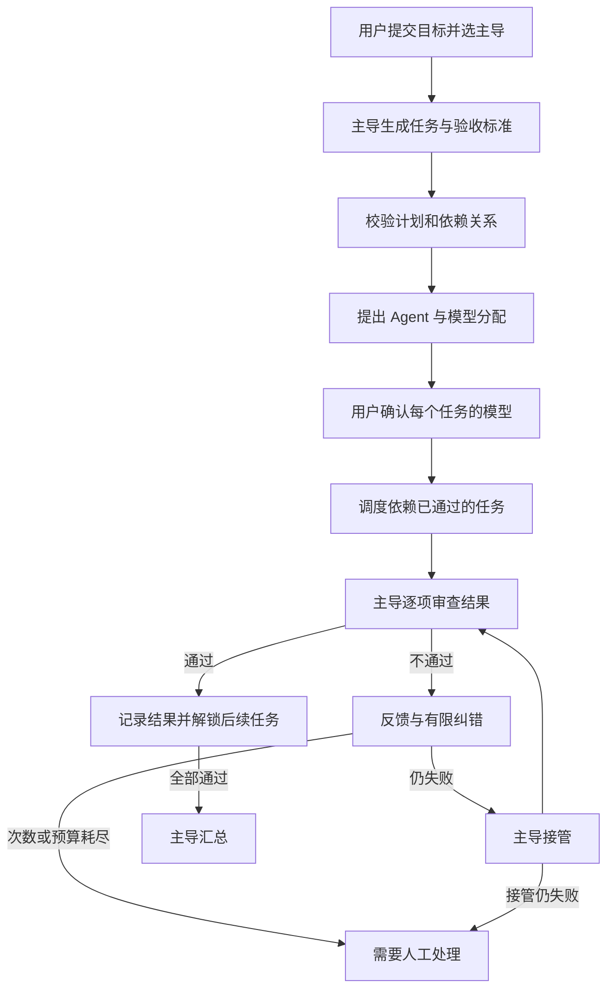

# 多 Agent 协同平台：架构与可靠性

第一版是本地运行的任务编排工作台。用户添加 Agent、选择主导 Agent，再确认每个子任务使用的 Agent 与模型。平台接入演示模型、兼容 OpenAI 的 API 和用户配置的本机 CLI。主导 Agent 负责规划、验收、纠错接管和最终汇总。

**能力边界：模型等级与模型审查都不能保证任务万无一失。** 本版的目标是让分工、验收依据、失败和接管过程可见，并限制失控重试。平台自身没有给模型提供自动修改项目文件、执行生成代码或任意 shell 命令的工具；本机 CLI 自身拥有的权限另由其运行配置决定。

## 组件和数据

| 组件 | 责任 |
| --- | --- |
| 浏览器界面 | 管理 Agent、指定主导、确认模型分配、展示结果与事件 |
| 本地 HTTP 服务 | 参数校验、状态读取、取消、结果导出；仅监听回环地址 |
| 编排引擎 | 解析计划、依赖调度、调用预算、主导审查、重试和接管 |
| Provider 适配层 | 统一演示、API、CLI 请求；传播取消信号并限制等待和输出 |
| JSON 状态存储 | 保存 Agent、任务、调用次数、尝试和事件；重启恢复边界 |

每次运行保存 Agent 配置快照，使后续修改配置不会改变本次分工记录。API 密钥使用环境变量名配置，状态文件和浏览器不需要收到密钥值。任务内容、模型输出和运行记录会保存到本地；发送给 API/CLI 的内容受对应服务和程序的数据处理方式约束。

## 编排流程

这张图表达有界的控制流，不能将接管后再审查理解为无限循环。当前执行者最多尝试两次，仍失败时由符合资格的主导接管一次；原本就分给主导的任务最多尝试两次。任何任务失败时，其后续依赖任务不得当作已经完成；取消或重启中断也不能生成成功结论。

## 分配规则

1. 用户配置的等级为经济、均衡、强力三级；它是能力和成本的粗略估计，不是实测算力，也不是厂商模型排名。
2. 候选 Agent 必须满足任务所需技能和最低等级。满足条件后优先分配较低等级，减少主导 Agent 的简单执行工作。
3. 高风险或复杂度为三级的任务由主导 Agent 执行。主导 Agent 仍负责所有任务的验收，并在必要时接管较简单的任务。
4. 规划后暂停并显示任务、验收标准、推荐 Agent 与模型；用户可以调整选择。服务端重新校验完整分配，确认前不执行子任务。
5. 依赖项只有在通过验收后才能供下游使用。执行时传递目标、当前任务、相关依赖结果和纠错反馈，避免把全部聊天历史无差别发送给每个模型。

无法找到合格 Agent 时，应显示原因并要求调整配置或计划，不能默默降级到不满足要求的模型。第一版的路由依据是用户配置；后续可以增加经用户授权的基准任务、历史通过率、延迟和费用统计，但仍应保留人工覆盖能力。

## 验收、纠错与停止条件

计划应在执行前提供可观察的验收标准。主导审查返回总判定、反馈和逐条证据；引擎应要求验收项完整且全部通过，不能只依据一个 `passed: true` 字段。模型自称“测试已通过”不能替代真实的测试结果。

失败反馈应说明缺少什么、哪里与验收标准矛盾，并交给执行者有限重试；继续失败时由满足等级和技能要求的主导接管，主导也不满足要求则转为待处理。接管结果也要验收。主导仍无法完成、结构化输出不合法、调用失败、预算不足等情况应显式结束或转为待处理，并保留已有结果和失败原因。

调用预算覆盖规划、执行、审查、纠错、接管和汇总；它是请求次数上限，不是金额上限。并发任务应在请求发出前占用预算，防止超额。独立任务可并行，但依赖顺序不可越过。取消需要传递到活动请求，并阻止迟到的返回值把运行重新标记为完成。

本版展示的是**模型审查通过**。对代码正确性、文件是否真的生成、测试是否真的运行，以及外部动作是否成功，只有接入对应的可验证工具后才能给出更强的证据。主导和执行者可能犯同类错误；增加一次模型审查并不能消除这种风险。

## API 与本机 CLI 的信任边界

API 连接地址和密钥环境变量由用户配置，模型输出不能修改这些设置。远端服务返回的数据和 Agent 输出属于任务内容，不能被当成平台配置、授权或系统指令。HTTP 服务应限制本机访问，并校验写请求来源和格式。

CLI 配置来自受信任的本地配置文件。程序路径、固定参数和工作目录应明确，平台不通过 shell 拼接模型生成的命令。Windows 下的 `.cmd` 包装脚本和可执行文件并不等价，宜使用真正的可执行文件，或 `node.exe` 加已确认的脚本入口。超时、取消、输出大小限制用于控制一次调用，但这不等于操作系统沙盒。

接入具备文件或命令工具的 CLI 前，应使用其受限模式，并为该 CLI 单独配置目录、凭据与权限。适配器在取消、超时或输出超限时尝试终止进程树；这不等于完整的操作系统资源隔离，复杂的守护进程和脱离进程树的程序仍需要额外约束与验证。

## 进入真实项目开发前的下一步

- **隔离工作目录：** 为执行者分配独立 Git worktree 或临时副本，由主导审查差异后整合；阻止多个执行者同时写相同文件。
- **可执行的验收：** 测试、类型检查、构建和静态分析通过受控工具运行，保存命令、退出码与产物；把模型意见与客观证据分别展示。
- **工具授权：** 采用允许列表、受限目录和明确的网络/凭据范围。发布、删除、迁移等动作独立授权，任务文本不能赋予新权限。
- **资源与费用：** 限制进程树、CPU、内存、磁盘、时间和真实 token/金额；资源受限时停止派发并给出可继续的状态。
- **可恢复运行：** 保留检查点、产物校验值和操作幂等键；只有确认外部动作未发生或可安全重放时才恢复执行。
- **校准路由：** 用项目自己的评估集衡量不同模型的首次通过率、纠错率与费用，在保留用户选择的前提下改进推荐。

以上增强项属于后续工程范围，不能把文档中的设计目标当作第一版已经具备的执行能力。
